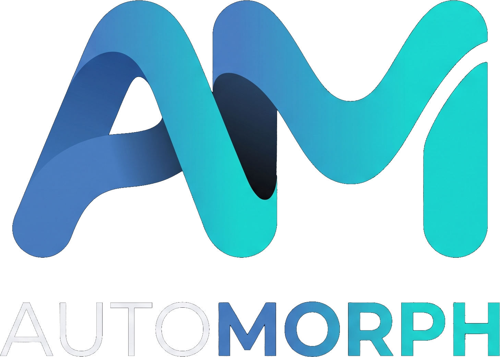
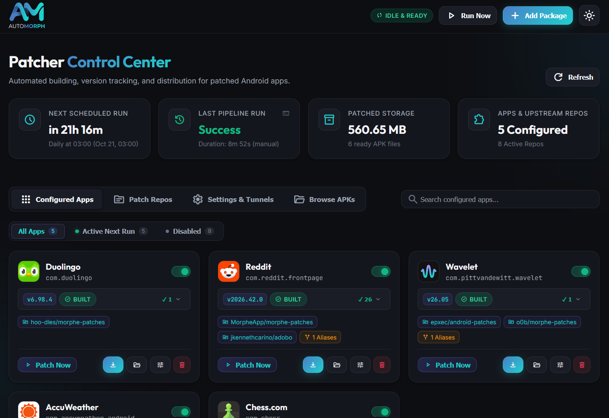
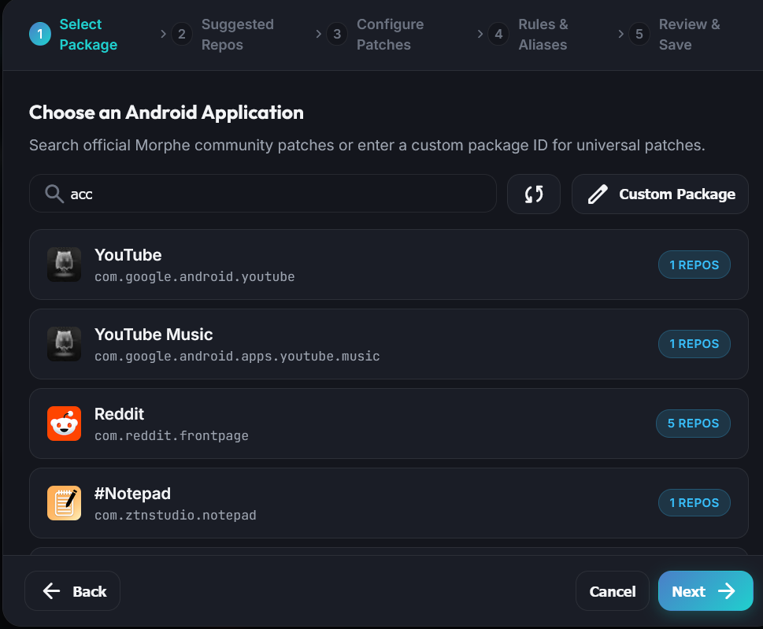
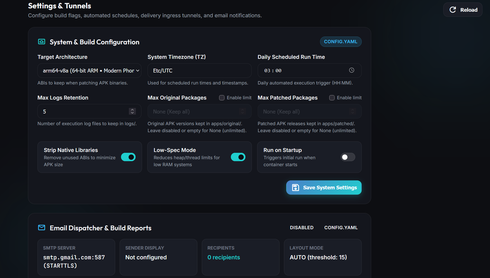

<div align="center">
  
  <p><br>A self-hosted tool for automatically patching and distributing Android packages, built on Morphe Desktop.</p>
</div>

## Key Features

- **Automated repo tracking:** Monitors patch repositories for updates.
- **Automatic APK downloads:** Downloads base APKs automatically, prioritising Google Play and falling back to APKCombo, Uptodown, and APKPure.
- **Email notifications and web portal:** Get email alerts with direct download links whenever a patch succeeds, or download builds directly from the web portal. *A dedicated Android app for notifications and downloads is planned.*
- **Scheduled or manual builds:** Run automatically once a day at a time of your choice, or start a build manually through the web interface.
- **Free hosting:** Designed to run within the free tier of Oracle Cloud Infrastructure.
  - Works with free **Pangolin tunnels** or **Tailscale Funnel** for a URL to access the web portal and downloads.
  - Supports **Cloudflare Tunnels** if you use a custom domain.

## Screenshots

### Control Center & Dashboard
<!-- Screenshot placeholder: Save a screenshot of the main dashboard to images/dashboard.png -->


### Add Package Wizard


### Settings & Tunnels


## Prerequisites

- Docker
- Docker Compose

## Don't Have a Server?

AutoMorph can run in low-spec mode on an Oracle Cloud free-tier instance. Check out the setup guide. An initialisation script is also provided to automate most of the setup.

## Quick Start

1. Download `compose.yaml` and `example.env`.
2. Fill in your details in `example.env`, then rename it to `.env`.
3. Run the following commands:

   ```bash
   docker compose pull
   docker compose up -d
   ```

See the documentation for more information on setup and configuration.

## A Note on AI

AutoMorph started as a personal project to practise and improve my Python skills. I wrote the vast majority of the backend and core logic myself. The web interface was mostly written with AI assistance, with me guiding the development.

## Acknowledgements

- **Morphe Desktop**
- **Obtainium** - Heavily inspired the package scraping and discovery methods.
- **goopdl** - For downloads from Google Play: https://github.com/Villoh/goopdl
